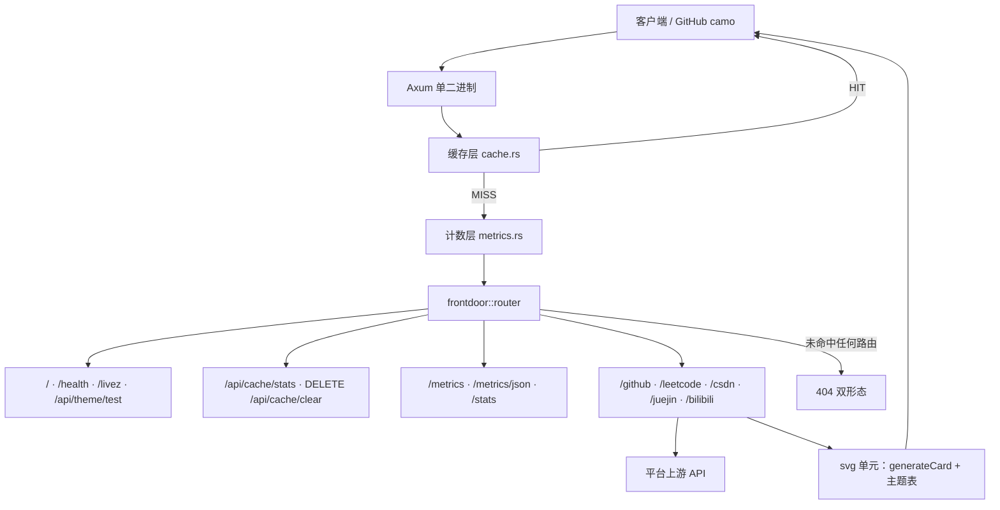

# GitHub Profile Statistics Card — 部署指南与架构说明

## 项目是什么

生成 GitHub、LeetCode、CSDN、掘金、哔哩哔哩个人统计卡片的服务，输出**自包含 SVG**，可直接嵌进 GitHub 个人资料页或任何能显示图片的位置。

后端是**单个 Rust 二进制**：进程内没有任何 Node、没有 npm 依赖、没有数据库连接、没有 Redis 连接。启动即服务，退出即结束。

## 架构



两层的顺序是行为的一部分，不是随意摆放：

1. **cache 在外层**（`axum` 里最后 `.layer()` 的在最外层）。缓存 HIT 直接返回，**不进计数层**——与原 Express 的 `app.ts:66 cache → :71 metrics` 挂载顺序一致。反过来会让 HIT 也计数，`/stats` 的 `requests.total` 立即虚高。
2. **metrics 在内层**，只统计真正走到路由的请求。

## 运行要求

- Linux x86_64 / aarch64（Debian bookworm 或同代 glibc），或 macOS（本地开发）
- 内存：约 30 MB 常驻（无 V8 堆、无连接池）
- 外网：需要能访问 `api.github.com`、`leetcode.com` / `leetcode.cn`、`blog.csdn.net`、`api.juejin.cn`、`api.bilibili.com` 与 `m.bilibili.com`
- **不需要**数据库、Redis、MongoDB、消息队列

## 环境变量

核心三个，全部可选（另有 Redis 四个变量，见下一节）：

| 变量 | 默认 | 作用 |
| --- | --- | --- |
| `PORT` | `8080` | 监听端口。云平台（Render/Railway/Fly）会自动注入，二进制直接读 |
| `GITHUB_TOKEN` | 空 | GitHub 个人访问令牌。**强烈推荐**：匿名额度只有 60 次/小时/**出口 IP**，部署在共享出口上几分钟就会打满，之后 GitHub 卡片会退化成「该平台暂无此用户的数据」。配置后额度是 5000 次/小时 |
| `BILIBILI_SESSDATA` | 空 | 哔哩哔哩登录 Cookie 里的 `SESSDATA`。不带时上游对 `x/space/upstat`、`x/relation/stat` 返回 `-352` 风控码，卡片会显示**全 0 的真实数据**（不是报错卡） |

其它历史变量（`MONGODB_URI`、`DATABASE_URL`、`USE_MEMORY_CACHE`、`NODE_ENV`、`RATE_LIMIT_*`、`*_CACHE_TTL`）**已无任何代码读取**，配了也不生效，可以从平台上一并删掉。

> `REDIS_*` 不在此列：缓存层已恢复，这四个变量会被真实读取，见下一节。

## 缓存：两层，第二层可选

两个变量名任选其一即可，与原版 Node 完全兼容，**不需要改名**：

```bash
# 方式一：单个 URL（云平台常用）
REDIS_URL=rediss://default:密码@主机:6379

# 方式二：拆分变量（老配置，原样可用）
REDIS_HOST=主机
REDIS_PORT=6379
REDIS_USERNAME=default
REDIS_PASSWORD=密码
```

`REDIS_URL` 优先；没有它才回落拆分变量。密码里的 `@ : /` 会被正确转义。

| 层 | 何时启用 | 寿命 | 作用 |
| --- | --- | --- | --- |
| L1 进程内 | 始终 | 响应的 `s-maxage`（10–60 分钟） | 零网络开销，最快路径 |
| L2 Redis | 配了 `REDIS_URL` **或** `REDIS_HOST` 时 | 同上 | 跨实例 / 跨冷启动共享 |

TTL 取自响应头的 `s-maxage`，所以「改平台的 s-maxage」会同时改掉 CDN 看到的头和本进程存的时长。

**两套变量都没配时，行为与单二进制部署完全一致**：不建连、不写、计数器不变。这让录制基线（153 条 case）继续有意义。

为什么值得配：GitHub 匿名额度只有 **60 次/小时/出口 IP**，而 `/github/{user}` 每次回源要打 2 个 REST 端点。多实例部署时每个实例都会各打一次上游，配额会被实例数除。实测 5 次冷启动：无 Redis 全部回源，有 Redis 只回源 1 次。

清缓存会同时清两层（`DELETE /api/cache/clear?all=true`），且**不用 `FLUSHDB`**——只按 `http:` 前缀 `SCAN`+`DEL`，以免误删同一 Redis 库里别的应用的数据。

## 本地运行

```bash
cargo build --release --workspace
GITHUB_TOKEN=ghp_xxx PORT=3000 ./target/release/app
```

打开 <http://127.0.0.1:3000/>；卡片在 `/github/<username>`。

## Docker 部署（推荐）

```bash
docker build -t github-stats-card .
docker run -d -p 3000:3000 \
  -e PORT=3000 \
  -e GITHUB_TOKEN=ghp_xxx \
  --name github-stats-card \
  github-stats-card
```

镜像构成（`Dockerfile` 多阶段）：

- **builder**：`rust:1.100-slim-bookworm`，`cargo build --release --locked`。**构建上下文只有 `rust/`**——首页模板在 `rust/app/views/index.html`，编译期被 `include_str!` 编进二进制。仓库里已经没有任何 JS/TS、没有 `package.json`、没有 `node_modules`。
- **runner**：`debian:bookworm-slim` + `ca-certificates` + `curl`（供 HEALTHCHECK），非 root 用户 `app`（uid 10001）。
- 最终镜像约 **158 MB**（实测），`command -v node` 返回空。

```yaml
# docker-compose.yml —— 不内置 redis service：Redis 是可选的外部依赖，
# 推荐直接连托管实例（Render Key Value / Upstash / Redis Labs）。
services:
  app:
    build: .
    ports:
      - "3000:3000"
    environment:
      - PORT=3000
      - GITHUB_TOKEN=${GITHUB_TOKEN}
      - BILIBILI_SESSDATA=${BILIBILI_SESSDATA}
      # 可选：配了才有跨实例共享缓存，不配则纯进程内
      - REDIS_HOST=${REDIS_HOST}
      - REDIS_PORT=${REDIS_PORT}
      - REDIS_USERNAME=${REDIS_USERNAME}
      - REDIS_PASSWORD=${REDIS_PASSWORD}
    restart: always
    healthcheck:
      test: ["CMD", "curl", "-fsS", "http://127.0.0.1:3000/health"]
      interval: 30s
      timeout: 3s
      retries: 3
```

> compose 里引用 `${GITHUB_TOKEN}` 时由 shell/compose 自身的 .env 提供，**不要把 token 写进 Dockerfile 或提交到仓库**。

## 托管平台

| 平台 | 配置方式 |
| --- | --- |
| **Render** | `render.yaml` 已写 `runtime: docker` + `dockerfilePath: ./Dockerfile` + `healthCheckPath: /livez`。Render 注入 `PORT` |
| **Railway** | `railway.json` 已写 `build.builder: DOCKERFILE`；Railway 发现 Dockerfile 时本来也会走 Docker 构建 |
| **任意容器平台** | 直接用仓库根的 `Dockerfile`，注入 `PORT` |
| **Vercel** | ✅ **支持，走官方 Rust runtime**（Beta）。入口是 `api/index.rs`，`vercel.json` 把所有路径 rewrite 到它。详见下节 |

探针语义区分（所有平台一致）：

- `/livez` —— 「进程还活着吗」。恒 200，不触达任何上游，**健康检查请用这个**
- `/health` —— 「上游都通吗」。未配 `GITHUB_TOKEN` / `BILIBILI_SESSDATA` 或上游限流时会报告 unhealthy，但进程本身仍正常服务

用 `/health` 当存活探针会让平台在 GitHub 限流时反复重启一个本来健康的实例。

## Vercel 部署

Vercel 提供**官方 Rust runtime**（Beta，全套餐可用），运行在 Fluid compute 上。本仓库已经接好：

```
Cargo.toml          ← 根 workspace + Vercel 入口的 [[bin]]
api/index.rs        ← serverless 入口（Vercel 把 api/*.rs 各编译成一个函数）
vercel.json         ← 把所有路径 rewrite 到 /api/index
.vercelignore       ← 排除 1.2G 的 target/
rust/app/src/lib.rs ← 真正的路由栈，两个入口共用
```

### 为什么只有一个函数

`rust/app/src/lib.rs` 里的 `router()` 同时被 `src/main.rs`（TCP / Docker）和 `api/index.rs`（Vercel）调用。**这是刻意的**：一份 stack，两个运行时，加一层中间件不可能只加在一边。

而把所有路径 rewrite 到**同一个函数**，是因为这个应用的行为依赖"路径如何不匹配"——大小写不敏感的挂载、单个尾斜杠、`//` 折叠、以及一个会回看原始路径的 404。把这些拆进 Vercel 的 rewrite 表，等于把路由语义搬到一个表达不了它们的层。

### 部署步骤

1. 推到 GitHub，在 Vercel 里 Import 这个仓库
2. Framework Preset 选 **Other**（不要选 Next.js，那会去找 `package.json`）
3. Root Directory 保持仓库根
4. 环境变量（可选，但强烈建议）：
   - `GITHUB_TOKEN` — 匿名配额只有 60 次/小时，**且 serverless 每次冷启动都是新进程，进程内缓存几乎不起作用**，不加 token 很容易在真实流量下打满
   - `BILIBILI_SESSDATA` — 缺省时 B 站数据会退化
5. Deploy

或走 CLI：

```bash
vercel deploy
```

### 本地验证 Vercel 入口

`vercel_runtime` 在没有 bridge 环境时会自己起一个 dev server（端口 3000），所以**不部署也能测**：

```bash
cargo build --release --workspace
./target/release/index
# 另一个终端
curl -s http://127.0.0.1:3000/health
curl -s -o /dev/null -w '%{http_code}\n' http://127.0.0.1:3000/github/octocat
```

### Vercel 上与 Docker 的行为差异

| 项 | Docker / 本地 | Vercel |
|---|---|---|
| 进程内缓存 | 常驻，跨请求有效 | **随实例存活**，冷启动即清空；多实例之间不共享 |
| `/api/cache/stats` | 反映本进程累计流量 | 每次冷启动归零，数值只代表当前实例 |
| 限流（300/15min） | 进程内计数，重启归零 | 同上；多实例各算各的，**实际阈值会被实例数放大** |
| 请求体大小 / 超时 | 自己控制 | 受 Vercel 套餐限制（`vercel.json` 里已设 `maxDuration: 60`） |

这些不是移植缺陷，是**无状态运行时的固有属性**。缓存语义在两边都正确，只是生命周期不同。需要跨实例共享缓存时，只能外接 Redis —— 那属于另一轮改动。

## 反向代理（Nginx）

二进制自己不做 TLS、不做压缩，这些交给前面的 Nginx：

```nginx
server {
    listen 80;
    server_name stats.example.com;

    location / {
        proxy_pass http://127.0.0.1:3000;
        proxy_http_version 1.1;
        proxy_set_header Host $host;
        proxy_set_header X-Real-IP $remote_addr;
        proxy_set_header X-Forwarded-For $proxy_add_x_forwarded_for;
        proxy_set_header X-Forwarded-Proto $scheme;
    }

    # 卡片响应已自带 Cache-Control，这里不要用 expires 覆盖它：
    # 成功卡片是 public, max-age=300, s-maxage=3600, stale-while-revalidate=86400，
    # 失败卡片是 public, max-age=60 —— 覆盖会让错误卡片被 CDN 缓存一小时。
    location ~ ^/(github|leetcode|csdn|juejin|bilibili)/ {
        proxy_pass http://127.0.0.1:3000;
        proxy_set_header Host $host;
        proxy_set_header X-Forwarded-For $proxy_add_x_forwarded_for;
    }
}
```

## 观测

- **`/livez`** —— 存活探针，`{"status":"alive","uptime":N}`
- **`/health`** —— 依赖健康，含 `database`（恒 unhealthy，本项目不用数据库）与 `platforms`
- **`/metrics`** —— Prometheus exposition 格式。**只报本进程真实拥有的 6 条**：`process_cpu_user_seconds_total`、`process_cpu_system_seconds_total`、`process_cpu_seconds_total`、`process_start_time_seconds`、`process_resident_memory_bytes`、`github_stats_cache_hit_rate`。原版的 `nodejs_*` 族（eventloop lag、GC、V8 heap space、libuv handle）**有意不再出现**：Rust 进程没有事件循环、没有 V8 堆、没有 libuv handle，打印这些数字等于把兼容演成谎言。
- **`/metrics/json`** —— 同一批数据的 JSON 形态，供调试
- **`/stats`** —— `{requests:{total,lastHour}, cache:{hits,misses,keys,groups,hitsRate}, externalApis:{github,leetcode}}`
- **`/api/cache/stats`** —— 缓存计数器（HTTP 层与 storage 层共用一套）
- **`DELETE /api/cache/clear?all=true`** —— 清空缓存条目（**不重置计数器**，与原实现一致）

## 缓存

进程内缓存，无外部依赖：

- **HTTP 层**：只缓存 GET/HEAD，`2xx` 且响应头不含 `no-store` 且 body < 512 KB 才回填；TTL 上限 60 秒，容量 500 条，超出按写入顺序淘汰最旧。`/health` 不参与缓存。
- **storage 层**：平台取数缓存（`BILIBILI:{uid}` 等），与 HTTP 层**共用同一份计数器**。
- 命中响应带 `X-Cache-Status: HIT` 与 `X-Cache-Key`。

**缓存是进程内的**：重启即清空，多实例之间不共享。这不是妥协——参考实现原本用 Redis 做跨实例共享，而本项目已移除全部外部依赖；如果确实需要多实例共享，应该在前面加一层 CDN（卡片响应已带 `s-maxage`，CDN 天然按 URL 缓存），而不是把 Redis 加回来。

## 常见问题

**卡片显示「该平台暂无此用户的数据」**

1. GitHub 卡片：先查限流。`curl -sI https://api.github.com/users/<name>` 看 `x-ratelimit-remaining`，为 0 就是匿名额度打满，配 `GITHUB_TOKEN`
2. CSDN 卡片：确认容器能访问 `blog.csdn.net`。CSDN 有 IP 风控，机房出口被 TLS 拒绝（`tlsv1 alert internal error`）时卡片会退化成这个错误卡
3. 哔哩哔哩卡片：显示**全 0** 而不是错误卡，说明上游全部被风控，配 `BILIBILI_SESSDATA`

**改完代码怎么验证**

```bash
cargo build --locked --workspace
cargo test  --locked --workspace
cargo clippy --locked --all-targets --workspace -- -D warnings
```

Vercel 入口（`api/index.rs`）与服务端二进制共用 `rust/app/src/lib.rs` 的路由栈。`vercel_runtime` 在没有 bridge 环境时会自动起 dev server，所以改完可以本地直接验：

```bash
cargo build --release --workspace
./target/release/index        # 监听 3000
```

行为契约不是手写断言，是 `rust/app-cases/` 里录制的 **153 条 HTTP case**，用 `rust-anything app replay` 重放。当前基线：**148/153**，5 条失败全部是录制期 Redis 残留键导致的 `x-cache-status HIT vs MISS` 差异，原始 Node 实现同样失败这 5 条。

## API

```
GET /github/:username?theme=light
GET /leetcode/:username?theme=light&cn=false
GET /csdn/:userId?theme=light
GET /juejin/:userId?theme=light
GET /bilibili/:uid?theme=light
```

公共查询参数：

- `theme`：`light`（默认）/ `dark` / `github-dark-dimmed` / `transparent`。未知值静默回落 `light`
- `cacheSeconds`：1–86400，越界或非数字回落 120
- `nocache=true`：跳过读取缓存

主题：

- `light` —— 明亮（默认，未知主题也回落此项）
- `dark` —— 暗黑
- `github-dark-dimmed` —— GitHub 暗色变体 `#22272e`
- `transparent` —— 透明背景

## 性能提示

1. **CDN 优先于缓存层**：卡片响应带 `s-maxage=3600`，Cloudflare 一类 CDN 直接按 URL 缓存，命中时连进程都不用来
2. **配 `GITHUB_TOKEN`**：这是唯一会因额度耗尽而降级的依赖
3. **不要把 `/metrics` 暴露到公网**：它含进程内部状态，只应给抓取端访问
4. 单实例足够：无状态、无外部连接，水平扩展只是复制进程

## 贡献

```bash
cargo test --workspace --locked          # 96 个单元测试
cargo clippy --locked -- -D warnings   # CI 会以 -D warnings 跑
```


## 许可证

MIT，见 [LICENSE](LICENSE)。