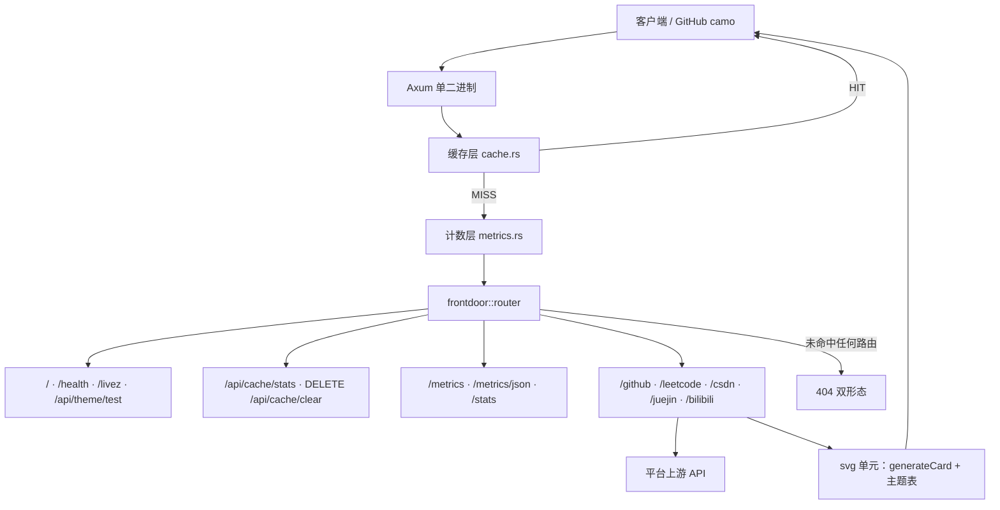

# GitHub Profile Statistics Card — 部署指南与架构说明

## 项目是什么

生成 GitHub、LeetCode、CSDN、掘金、哔哩哔哩个人统计卡片的服务，输出**自包含 SVG**，可直接嵌进 GitHub 个人资料页或任何能显示图片的位置。

后端是**单个 Rust 二进制**：进程内没有任何 Node、没有 npm 依赖、没有数据库连接、没有 Redis 连接。启动即服务，退出即结束。

## 架构



两层的顺序是行为的一部分，不是随意摆放：

1. **cache 在外层**（`axum` 里最后 `.layer()` 的在最外层）。缓存 HIT 直接返回，**不进计数层**——与原 Express 的 `app.ts:66 cache → :71 metrics` 挂载顺序一致。反过来会让 HIT 也计数，`/stats` 的 `requests.total` 立即虚高。
2. **metrics 在内层**，只统计真正走到路由的请求。

## 运行要求

- Linux x86_64 / aarch64（Debian bookworm 或同代 glibc），或 macOS（本地开发）
- 内存：约 30 MB 常驻（无 V8 堆、无连接池）
- 外网：需要能访问 `api.github.com`、`leetcode.com` / `leetcode.cn`、`blog.csdn.net`、`api.juejin.cn`、`api.bilibili.com` 与 `m.bilibili.com`
- **不需要**数据库、Redis、MongoDB、消息队列

## 环境变量

核心四个，全部可选（另有 Redis 四个变量，见下一节）：

| 变量 | 默认 | 作用 |
| --- | --- | --- |
| `PORT` | `8080` | 监听端口。云平台（Render/Railway/Fly）会自动注入，二进制直接读 |
| `GITHUB_TOKEN` | 空 | GitHub 个人访问令牌。**强烈推荐**：匿名额度只有 60 次/小时/**出口 IP**，部署在共享出口上几分钟就会打满，之后 GitHub 卡片会退化成「该平台暂无此用户的数据」。配置后额度是 5000 次/小时 |
| `BILIBILI_SESSDATA` | 空 | 哔哩哔哩登录 Cookie 里的 `SESSDATA`。不带时上游对 `x/space/upstat`、`x/relation/stat` 返回 `-352` 风控码，卡片会显示**全 0 的真实数据**（不是报错卡） |
| `TRUST_PROXY` | 空（视为 `0`） | **只在有反向代理时配**。限流按客户端计数，默认用 TCP 对端地址；填代理层数后改为读 `X-Forwarded-For` 里代理追加的那几项。直连（`docker run -p 3000:3000`）不要配，配错会让限流对不上人 |
| `CACHE_CLEAR_TOKEN` | 空（= 端点关闭） | `DELETE /api/cache/clear` 的 Bearer 凭据。**留空时该端点一律 403**，不是「无鉴权放行」。见下方「清缓存的凭据」 |

其它历史变量（`MONGODB_URI`、`DATABASE_URL`、`USE_MEMORY_CACHE`、`NODE_ENV`、`RATE_LIMIT_*`、`*_CACHE_TTL`）**已无任何代码读取**，配了也不生效，可以从平台上一并删掉。

> `REDIS_*` 不在此列：缓存层已恢复，这四个变量会被真实读取，见下一节。

### 限流键：`TRUST_PROXY`

限流按客户端地址计数。地址默认取 **TCP 对端地址**，因为这是请求里唯一客户端无法伪造的东西。原版 Node 直接读 `X-Forwarded-For` 原值，等于让每个访客自己决定归到哪个桶——实测同一 IP 连打是 `299 → 298 → 297`，每次换一个伪造值就永远是 `299`。

但放在反向代理后面时，对端地址是代理自己，所有访客会被算成同一个客户端。这时才需要声明层数：

```bash
TRUST_PROXY=1   # 前面一层代理（Render / Railway / 单层 Nginx）
TRUST_PROXY=2   # 前面两层（CDN + 源站 Nginx）
```

读法是「右起第 N 项」：你运维的 N 层代理会把客户端地址追加在右边，所以客户端是这些项的左边一个；更左边的值仍由访客自己写，不读。没填、填非数字、填负数都视为 0（不信任任何头）——一个手误应该损失精度，不该损失安全。

两个边界：链比声明的层数短，视为这次请求没穿过预期的代理，回落到对端地址；链里任何一项不是合法地址，整条头作废并回落——**不做「跳过垃圾项继续数」**，否则随手加个垃圾前缀就能把计数挪到别人身上。

`docker run -p 3000:3000` 是直连，**不要配这个变量**。

另有一条独立的保护：桶的 key 可能来自请求头，所以客户端表有 10000 个槽位的硬上限，超了按插入顺序淘汰最早的。伪造值改不动自己的计数了，但也不能借它把内存撑爆。

## 缓存：两层，第二层可选

两个变量名任选其一即可，与原版 Node 完全兼容，**不需要改名**：

```bash
# 方式一：单个 URL（云平台常用）
REDIS_URL=rediss://default:密码@主机:6379

# 方式二：拆分变量（老配置，原样可用）
REDIS_HOST=主机
REDIS_PORT=6379
REDIS_USERNAME=default
REDIS_PASSWORD=密码
```

`REDIS_URL` 优先；没有它才回落拆分变量。密码里的 `@ : /` 会被正确转义。

| 层 | 何时启用 | 寿命 | 作用 |
| --- | --- | --- | --- |
| L1 进程内 | 始终 | 响应的 `s-maxage`（10–60 分钟） | 零网络开销，最快路径 |
| L2 Redis | 配了 `REDIS_URL` **或** `REDIS_HOST` 时 | 同上 | 跨实例 / 跨冷启动共享 |

TTL 取自响应头的 `s-maxage`，所以「改平台的 s-maxage」会同时改掉 CDN 看到的头和本进程存的时长。

**两套变量都没配时，行为与单二进制部署完全一致**：不建连、不写、计数器不变。这让录制基线（153 条 case）继续有意义。

为什么值得配：GitHub 匿名额度只有 **60 次/小时/出口 IP**，而 `/github/{user}` 每次回源要打 2 个 REST 端点。多实例部署时每个实例都会各打一次上游，配额会被实例数除。实测 5 次冷启动：无 Redis 全部回源，有 Redis 只回源 1 次。

清缓存会同时清两层（`DELETE /api/cache/clear?all=true`），且**不用 `FLUSHDB`**——只按 `http:` 前缀 `SCAN`+`DEL`，以免误删同一 Redis 库里别的应用的数据。

正因为会清到共享层，这个端点在移植时补上了凭据：一次匿名调用在原版只清一个进程的 map，在这里会让所有实例同时回源，而 GitHub 匿名额度只有 60 次/小时。详见下一节。

### 清缓存的凭据：`CACHE_CLEAR_TOKEN`

`DELETE /api/cache/clear` 在新版 Node 里是无鉴权的（`bae577b^:src/app.ts:92` 直接把 `manualCacheClearHandler` 挂在路由上），那在**只有进程内缓存**时还过得去：一次调用只清掉一个进程的 map，下一个请求回源一次就补回来了。

移植时加了 Redis 共享层，风险性质就变了。同一行代码现在做的是「让整个舰队同时回源」，而 GitHub 匿名额度只有 60 次/小时/出口 IP，`/github/{user}` 每次回源还要打 2 个端点。一次误触就够把当天额度烧完，之后所有 GitHub 卡片退化成「暂无数据」。

所以这里是**默认拒绝**，而不是「原样搬过来 + 建议加个网关」：

| 状态 | 行为 |
| --- | --- |
| 没配 `CACHE_CLEAR_TOKEN` | 一律 `403`，`msg` 点名缺的是哪个变量 |
| 配了，但没带凭据 / scheme 不对 / 值不对 | `401` + `WWW-Authenticate: Bearer` |
| 配了，凭据正确 | 按 `?all=` / `?group=` / `?pattern=` 正常执行 |

三个实现细节值得知道，因为它们各自挡掉一种真实的绕过：

1. **空值视为未配置。** 平台经常定义一个值为空的环境变量。把空串读成「期望令牌是空串」，会让 `Authorization: Bearer`（后面什么都没有）成为第一个被猜中的口令。
2. **长度参与比较。** 令牌比较是手写的、不因提前失配而短路的循环。但如果只走循环，`Bearer <正确值>EXTRA` 也会通过——循环只遍历期望值，多出来的字节它不看。长度差异必须折进同一个累加器。
3. **scheme 必须字面是 `Bearer`（大小写不敏感）。** 否则 `Basic <正确令牌>` 也能进，检查就退化成「有某个词，然后是秘密」。

```bash
# 未配置时：
$ curl -s -X DELETE 'http://127.0.0.1:8080/api/cache/clear?all=true'
{"code":403,"msg":"Cache clearing is disabled: CACHE_CLEAR_TOKEN is not set","data":null}

# 配置后：
$ CACHE_CLEAR_TOKEN=s3cret-token PORT=3000 ./target/release/app &
$ curl -s -o /dev/null -w '%{http_code}\n' -X DELETE 'http://127.0.0.1:3000/api/cache/clear?all=true'
401
$ curl -s -X DELETE -H 'Authorization: Bearer s3cret-token' \
    'http://127.0.0.1:3000/api/cache/clear?all=true'
{"code":200,"msg":"Cleared all cache","data":{"deletedCount":"all"}}
```

令牌只从环境变量读，没有写进仓库的默认值。生成一个就够：`openssl rand -hex 32`。换令牌等于让旧值立刻失效，不需要重启以外的任何操作。

拒绝响应同样带 `Cache-Control: no-store`：一条被 CDN 记住的 403 会活得比产生它的那个环境变量还久，改完配置也解不开。

## 本地运行

```bash
cargo build --release --workspace
GITHUB_TOKEN=ghp_xxx PORT=3000 ./target/release/app
```

打开 <http://127.0.0.1:3000/>；卡片在 `/github/<username>`。

## Docker 部署（推荐）

```bash
docker build -t github-stats-card .
docker run -d -p 3000:3000 \
  -e PORT=3000 \
  -e GITHUB_TOKEN=ghp_xxx \
  --name github-stats-card \
  github-stats-card
```

镜像构成（`Dockerfile` 多阶段）：

- **builder**：`rust:1.100-slim-bookworm`，`cargo build --release --locked`。**构建上下文只有 `rust/`**——首页模板在 `views/index.html`，编译期被 `include_str!` 编进二进制。仓库里已经没有任何 JS/TS、没有 `package.json`、没有 `node_modules`。
- **runner**：`debian:bookworm-slim` + `ca-certificates` + `curl`（供 HEALTHCHECK），非 root 用户 `app`（uid 10001）。
- 最终镜像约 **158 MB**（实测），`command -v node` 返回空。

```yaml
# docker-compose.yml —— 不内置 redis service：Redis 是可选的外部依赖，
# 推荐直接连托管实例（Render Key Value / Upstash / Redis Labs）。
services:
  app:
    build: .
    ports:
      - "3000:3000"
    environment:
      - PORT=3000
      - GITHUB_TOKEN=${GITHUB_TOKEN}
      - BILIBILI_SESSDATA=${BILIBILI_SESSDATA}
      # 可选：配了才有跨实例共享缓存，不配则纯进程内
      - REDIS_HOST=${REDIS_HOST}
      - REDIS_PORT=${REDIS_PORT}
      - REDIS_USERNAME=${REDIS_USERNAME}
      - REDIS_PASSWORD=${REDIS_PASSWORD}
    restart: always
    healthcheck:
      test: ["CMD", "curl", "-fsS", "http://127.0.0.1:3000/health"]
      interval: 30s
      timeout: 3s
      retries: 3
```

> compose 里引用 `${GITHUB_TOKEN}` 时由 shell/compose 自身的 .env 提供，**不要把 token 写进 Dockerfile 或提交到仓库**。

## 托管平台

| 平台 | 配置方式 |
| --- | --- |
| **Render** | `render.yaml` 已写 `runtime: docker` + `dockerfilePath: ./Dockerfile` + `healthCheckPath: /livez`。Render 注入 `PORT` |
| **Railway** | `railway.json` 已写 `build.builder: DOCKERFILE`；Railway 发现 Dockerfile 时本来也会走 Docker 构建 |
| **任意容器平台** | 直接用仓库根的 `Dockerfile`，注入 `PORT` |
| **Vercel** | ✅ **支持，走官方 Rust 框架**。入口是仓库根的 `src/main.rs`，`@vercel/rust` 负责构建。详见下节 |

探针语义区分（所有平台一致）：

- `/livez` —— 「进程还活着吗」。恒 200，不触达任何上游，**健康检查请用这个**
- `/health` —— 「上游都通吗」。`data.status` 有三种答案：`healthy`（问过的平台最近一次都成功）、`unhealthy`（至少一个平台最近一次失败，例如未配 `GITHUB_TOKEN` 撞上匿名配额限流）、`unknown`（启动后还没有任何卡片请求，无从判断）。无论哪种，进程本身都仍在正常服务

用 `/health` 当存活探针会让平台在 GitHub 限流时反复重启一个本来健康的实例。

## Vercel 部署

Vercel 提供**官方 Rust runtime**（Beta，全套餐可用），运行在 Fluid compute 上。本仓库已经接好：

```
Cargo.toml          ← 根 workspace，根 package 就是 Vercel 入口
src/main.rs         ← Vercel 入口：监听 $PORT 的普通 axum 服务
vercel.json         ← framework: rust（高于自动检测）
.vercelignore       ← 排除 target/ 等构建产物
src/lib.rs ← 真正的路由栈，两个入口共用
```

### 为什么只有一个函数

`src/lib.rs` 里的 `router()` 由唯一的 `src/main.rs` 调用。**Docker 与 Vercel 跑的是同一份二进制**——两者都只是「监听 `$PORT` 的 axum 服务」，由平台侧把流量转进来。所以加一层中间件不可能只影响一种部署。

而把所有路径 rewrite 到**同一个函数**，是因为这个应用的行为依赖"路径如何不匹配"——大小写不敏感的挂载、单个尾斜杠、`//` 折叠、以及一个会回看原始路径的 404。把这些拆进 Vercel 的 rewrite 表，等于把路由语义搬到一个表达不了它们的层。

### 必配：PUBLIC_BASE_URL

```bash
PUBLIC_BASE_URL=https://你的项目.vercel.app
```

首页画廊的示例链接要用公开域名拼。**不配这一项，Vercel 上的卡片会全部 302 跳到 SSO 登录页。**

原因：Vercel 给每个部署分配一个带哈希的域名（`<project>-<hash>-<team>.vercel.app`），它是**受 SSO 保护的**，而 `Host` 头带的就是这个域名。首页照它拼出来的图片地址全都指向 SSO 后面，于是浏览器拿到 302 而不是 SVG。Vercel 不发送 `x-forwarded-host`，所以请求里没有更好的信息可读，只能由环境变量显式指定。

本地与 Docker 不需要它：那里的 `Host` 头就是对的。

### 部署步骤

1. 推到 GitHub，在 Vercel 里 Import 这个仓库
2. Framework Preset 选 **Other**（不要选 Next.js，那会去找 `package.json`）
3. Root Directory 保持仓库根
4. 环境变量（可选，但强烈建议）：
   - `GITHUB_TOKEN` — 匿名配额只有 60 次/小时，**且 serverless 每次冷启动都是新进程，进程内缓存几乎不起作用**，不加 token 很容易在真实流量下打满
   - `BILIBILI_SESSDATA` — 缺省时 B 站数据会退化
5. Deploy

或走 CLI：

```bash
vercel deploy
```

### 本地验证 Vercel 入口

Vercel 入口就是一个监听 `$PORT` 的普通 axum 服务，**不部署也能直接跑**：

```bash
cargo build --release
PORT=3000 ./target/release/app
# 另一个终端
curl -s http://127.0.0.1:3000/health
curl -s -o /dev/null -w '%{http_code}\n' http://127.0.0.1:3000/github/octocat
```

> **为什么不是 `api/index.rs`**：Vercel 的 Rust 检测条件是 `Cargo.toml` **与** `src/main.rs` 同时存在。放在 `api/` 下不满足检测，手动选 `Other` 也不会挂上 `@vercel/rust` 构建器——表现就是"选了也不运行"。这是排查时踩过的坑。

### Vercel 上与 Docker 的行为差异

| 项 | Docker / 本地 | Vercel |
|---|---|---|
| 进程内缓存 | 常驻，跨请求有效 | **随实例存活**，冷启动即清空；多实例之间不共享 |
| `/api/cache/stats` | 反映本进程累计流量 | 每次冷启动归零，数值只代表当前实例 |
| 限流（300/15min） | 进程内计数，重启归零 | 同上；多实例各算各的，**实际阈值会被实例数放大** |
| 请求体大小 / 超时 | 自己控制 | 受 Vercel 套餐限制（Hobby 计划函数有执行时长上限） |

这些不是移植缺陷，是**无状态运行时的固有属性**。缓存语义在两边都正确，只是生命周期不同。需要跨实例共享缓存时，只能外接 Redis —— 那属于另一轮改动。

## 反向代理（Nginx）

二进制自己不做 TLS、不做压缩，这些交给前面的 Nginx：

```nginx
server {
    listen 80;
    server_name stats.example.com;

    location / {
        proxy_pass http://127.0.0.1:3000;
        proxy_http_version 1.1;
        proxy_set_header Host $host;
        proxy_set_header X-Real-IP $remote_addr;
        proxy_set_header X-Forwarded-For $proxy_add_x_forwarded_for;
        proxy_set_header X-Forwarded-Proto $scheme;
    }

    # 卡片响应已自带 Cache-Control，这里不要用 expires 覆盖它：
    # 成功卡片是 public, max-age=300, s-maxage=3600, stale-while-revalidate=86400，
    # 失败卡片是 public, max-age=60 —— 覆盖会让错误卡片被 CDN 缓存一小时。
    location ~ ^/(github|leetcode|csdn|juejin|bilibili)/ {
        proxy_pass http://127.0.0.1:3000;
        proxy_set_header Host $host;
        proxy_set_header X-Forwarded-For $proxy_add_x_forwarded_for;
    }
}
```
上面这份配置会追加 `X-Forwarded-For`，所以要**同时**给进程配 `TRUST_PROXY=1`，否则限流会把所有访客算成 Nginx 自己的地址（`127.0.0.1`），第 301 个访客起全部被限。反过来，直连部署配了这个变量，等于把限流键交给访客自己填。

## 观测

- **`/livez`** —— 存活探针，`{"code":200,"msg":"ok","data":{"status":"alive","uptime":N}}`
  - `uptime` 是**进程真实年龄**（秒，向下取整），取自内核记录的进程启动时刻（macOS `proc_pidinfo(PROC_PIDTBSDINFO)`、Linux `/proc/self/stat` 的 starttime + `/proc/stat` 的 btime），与 `/metrics` 的 `process_start_time_seconds` 同源。不是「首次探活以来」的计时器——那样启动一分钟的服务第一次探活会答 `uptime: 0`。
  - 读不到启动时刻的平台（非 macOS / Linux）答 `uptime: null`，不是 `0`：`0` 会被读成「刚启动」，`null` 才是「这个构建测不出来」。
  - 这一条**单元测试盖不全**：`tests/live_diagnostics.rs` 里那条测试的参考读数与秒表起点几乎同时，两种实现都能通过。CI 里另跑 `scripts/process-age.sh`——起进程、等 5 秒、只探一次，要求 `uptime >= 5`。它探就绪用的是 TCP 连接而不是 `/livez`，因为用 `/livez` 轮询本身就是第一次探测。
- **`/health`** —— 依赖健康，含 `status`、`database`、`platforms`、`memory` 与 `uptime`（同上，同源同语义）
  - `status` 是**上游通不通**，从下面的 `platforms` 计数派生，两者出自同一次快照，不会自相矛盾。三态：`healthy` 每个被问过的平台最近一次都成功；`unhealthy` 至少一个平台最近一次失败；`unknown` 启动后还没人请求过任何卡片（空对象既不是健康也不是不健康）。只读**最近一次**——失败后恢复的平台会把字段带回 `healthy`，它回答「现在通不通」而不是「有没有出过错」。平局（`lastOkAt == lastFailureAt`，同一毫秒）判给失败：健康字段多报问题会被查，少报问题会被信。
  - `database` 恒为 `{"status":"not_configured","pool":{"isConnected":false,"poolSize":0}}`——本项目不接数据库，这个状态说的是「没配」，不是「坏了」。原版 Node 把它绑在 PostgreSQL 连接状态上，Rust 版没有那个依赖，早先照抄成 `unhealthy`，等于宣称一个从不存在的数据库故障中，运维会去找一条不该存在的连接串。
  - `platforms` 是**真实调用计数**，不是占位：每个被请求过的平台一条 `{ok, fail, lastOkAt?, lastFailureAt?, lastError?}`，`lastError` 取 `NOT_FOUND` / `RATE_LIMITED` / `DATA_UNAVAILABLE` / `UPSTREAM_ERROR`。上游静默失效（掘金返回空壳、CSDN 返 521）时这里能直接看出来。从未被请求过的平台不出现——空对象是「还没人问」，不是「全挂了」。
  - 计数在进程内累积、重启清零；`/health` 自身不参与缓存也不计数，所以监控轮询不会把数字算成流量。
  - `memory` 只报 `{ "rss": N }` —— 常驻内存字节数，真实测量。原版 `process.memoryUsage()` 的另外四个键（`heapTotal` / `heapUsed` / `external` / `arrayBuffers`）是 V8 的账目，Rust 进程没有对应物，**不再输出**：留着恒 0 的键和 `/metrics` 里删掉的 `nodejs_*` 族是同一种谎。读 `memory.rss` 的消费者不受影响；读 V8 四键的消费者本来读到的就是常数 0。
- **`/metrics`** —— Prometheus exposition 格式。**只报本进程真实拥有的 6 条**：`process_cpu_user_seconds_total`、`process_cpu_system_seconds_total`、`process_cpu_seconds_total`、`process_start_time_seconds`、`process_resident_memory_bytes`、`github_stats_cache_hit_rate`。原版的 `nodejs_*` 族（eventloop lag、GC、V8 heap space、libuv handle）**有意不再出现**：Rust 进程没有事件循环、没有 V8 堆、没有 libuv handle，打印这些数字等于把兼容演成谎言。
- **`/metrics/json`** —— 同一批数据的 JSON 形态，供调试
- **`/stats`** —— `{code:200, msg:"ok", data:{requests:{total,lastHour}, cache:{hits,misses,keys,groups,hitsRate}, externalApis:{github,leetcode,csdn,juejin,bilibili}}}`
  - `requests.lastHour` 是**真正滚动的一小时**：60 个按分钟桶，进出两个方向都做惰性轮转（`advance`），所以没有后台任务，进程空转一天也不会攒着旧数字——下一次被问到时它先把自己转到当下再求和。分辨率是分钟：窗口是「当前这一分钟 + 之前 59 分钟」。
    - 原版 Node 在 `metrics.middleware.ts` 里把 `global.requestCount` 和 `global.requestCountLastHour` 一起 `++` 且从不重置，`metrics.routes.ts` 又把后者当 `lastHour` 发出去，于是这两个数在整个进程生命周期里恒等——一个名字承诺了窗口、代码从未打开过窗口的字段。照抄它就等于把总量挂牌成一小时量，和保留 V8 那四个恒 0 的内存键、把 `database` 写成 `unhealthy` 是同一种谎。
    - 时钟回拨（NTP 步进）不会抹掉已发生的计数：窗口只前进不后退，`advance` 对 `minute <= window.minute` 直接返回。宁可暂时少算，也不把真实发生过的请求删掉——删掉的分钟没有任何东西能补回来。
    - 这个字段的**忘记**没法在 CI 里等一小时验证，所以 `tests/last_hour_window.rs` 用 `metrics::age_last_hour_for_tests(61)` 走同一段轮转代码把窗口推到一小时之后，断言 `lastHour` 归零而 `total` 只前进它自己那一次。换成「lastHour 最多等于 total」这种断言是没用的——原缺陷恰好满足它。
  - `externalApis` **每个已注册平台一个键，全部是真实出站请求数**，键集合与顺序由 `src/frontdoor/registry.rs` 的平台表派生，接入新平台自动有这个键。原版 Node 只声明了 `githubApiCallCount` 却从未递增，而输出也只有 `github`/`leetcode` 两个键——这里把两条都补上了。
  - 计数点在"请求被构造出来"的那一刻，不是"请求成功"的那一刻：超时的请求同样占用上游配额，只统计成功会恰好在出问题时少报。重试不重复计，这个数回答的是"给上游送了多少流量"。
  - 一张卡片实际发几次上游请求，就计几次：`github` 2 次（profile + repos），`leetcode` 按区域尝试次数，`csdn` 1 次（抓 profile 页），`juejin` 2 次（用户 GET 与文章列表 POST 并发），`bilibili` 4 次（空间页 + stat + upstat + card）。
  - 响应带 `Cache-Control: no-store`，详见「缓存」一节。
- **`/api/cache/stats`** —— 缓存计数器（HTTP 层与 storage 层共用一套）
- **`DELETE /api/cache/clear?all=true`** —— 清空缓存条目（**不重置计数器**，与原实现一致）。**需要凭据**：必须带 `Authorization: Bearer <CACHE_CLEAR_TOKEN>`，未配置该变量时返回 403；见下方「清缓存的凭据」

## 缓存

进程内缓存，无外部依赖：

- **HTTP 层**：只缓存 GET/HEAD，`2xx` 且响应头不含 `no-store` 且 body < 512 KB 才回填；TTL 取响应的 `s-maxage`（上限 3600 秒），容量 500 条，超出按写入顺序淘汰最旧。`/health` 不参与缓存。
- **诊断端点一律 `Cache-Control: no-store`**：`/livez`、`/health`、`/metrics`、`/metrics/json`、`/stats`、`/api/cache/stats`。这些响应体是**当前读数**，不是文档：缓存住就等于把「上一秒的计数器」当答案再发一次。没有 `no-store` 时它们会落到默认 300 秒 TTL，实测第一次 `MISS`、之后全是 `HIT`——Prometheus 抓到的是上一轮的值，`/stats` 连读两次数字不动。由于中间件只按 `no-store` 判定是否回填，写这个词就够了，不需要在中间件里再加路径白名单。
- **首页 `/` 例外**：首页 HTML 把请求的 `Host` 烤进画廊图片 URL，缓存 key（method:path:query）不含 host，进缓存会让第一个访问的 host 的链接污染所有后续 host，故首页**跳过进程内缓存**（安全头与 `X-Cache-*` 标记照常输出；共享缓存仍按完整 URL 缓存，不受影响）。
- **storage 层**：平台取数缓存（`BILIBILI:{uid}` 等），与 HTTP 层**共用同一份计数器**。
- 命中响应带 `X-Cache-Status: HIT` 与 `X-Cache-Key`。

**缓存是进程内的**：重启即清空，多实例之间不共享。这不是妥协——参考实现原本用 Redis 做跨实例共享，而本项目已移除全部外部依赖；如果确实需要多实例共享，应该在前面加一层 CDN（卡片响应已带 `s-maxage`，CDN 天然按 URL 缓存），而不是把 Redis 加回来。

## 常见问题

**卡片显示「该平台暂无此用户的数据」**

1. GitHub 卡片：先查限流。`curl -sI https://api.github.com/users/<name>` 看 `x-ratelimit-remaining`，为 0 就是匿名额度打满，配 `GITHUB_TOKEN`
2. CSDN 卡片：确认容器能访问 `blog.csdn.net`。CSDN 有 IP 风控，机房出口被 TLS 拒绝（`tlsv1 alert internal error`）时卡片会退化成这个错误卡
3. 哔哩哔哩卡片：显示**全 0** 而不是错误卡，说明上游全部被风控，配 `BILIBILI_SESSDATA`

**为什么 Node 版在 Vercel 上一切正常，Rust 版只有某个域名能显示？**

两版代码都有同一个缺陷：首页画廊按 ``${req.protocol}://${req.get('host')}`` 拼图片 URL，而响应缓存的 key（method:path:query）**不含 host**。同一个进程先后服务两个不同 host 时，第一个 host 的链接会污染后续所有请求。区别在运行时模型放大了这个窗口：

- **Node 版**：Vercel 上是 `@vercel/node` serverless 函数。每次冷启动都是新进程，L1 内存缓存随进程生灭；且 L1 TTL 封顶 **60 秒**。污染窗口 = 「同一 warm 实例 + 60 秒内 + 先后两个不同 host」，固定域名访问时几乎不可能触发。
- **Rust 版**：Vercel Rust runtime 是监听 `$PORT` 的**常驻进程**，L1 跨请求存活，TTL 取 `s-maxage` 上限 **3600 秒**。污染窗口 = 「谁先来谁占坑一小时」。多域名（预览域名、带哈希域名、主域名）打同一进程时，第一个请求的 host 就是唯一赢家。

修复：首页跳过进程内缓存（见「缓存」一节）。Vercel 上的带哈希域名另有 SSO 保护问题，配 `PUBLIC_BASE_URL`（见上文）。

**改完代码怎么验证**

```bash
cargo build --locked --workspace
cargo test  --locked --workspace
cargo clippy --locked --all-targets --workspace -- -D warnings
```

Vercel 入口与服务端二进制共用 `src/lib.rs` 的路由栈，所以改完可以本地直接验：

```bash
cargo build --release
PORT=3000 ./target/release/app
```

行为契约不是手写断言，是 `rust/app-cases/` 里录制的 **153 条 HTTP case**，用 `./scripts/replay.sh` 重放（它把时钟钉回录制日 2026-11-21，否则卡片 footer 的 `更新于` 会让 25 条 case 假失败）；只想确认代码没坏就跑 `./scripts/replay.sh gate`，111 条纯本地、不打上游。基线：**148/153**，5 条失败全部是 `x-cache-status` 的 `HIT vs MISS`——录制工具对每条 case 跑两遍，第二遍命中第一遍写下的进程内 L1，基线因此钉死 `HIT`；干净进程里录同一路径得到的是 `MISS`。属采样副作用，非行为差异。

## API

```
GET /github/:username?theme=light
GET /leetcode/:username?theme=light&cn=false
GET /csdn/:userId?theme=light
GET /juejin/:userId?theme=light
GET /bilibili/:uid?theme=light
```

公共查询参数：

- `theme`：`light`（默认）/ `dark` / `github-dark-dimmed` / `transparent`。未知值静默回落 `light`
- `cacheSeconds`：1–86400，越界或非数字回落 120
- `nocache=true`：绕开**平台取数缓存**（`BILIBILI:{uid}` 那一层），让这一次真的回源。它**不**绕开 HTTP 响应缓存——它只是把 `nocache=true` 带进缓存键，所以同一个 URL 连打第二次依然 `HIT`。要每次都回源就换 key 或先清缓存。与 Node 版行为一致（原版 `skipCache` 也只挂在平台中间件上）

主题：

- `light` —— 明亮（默认，未知主题也回落此项）
- `dark` —— 暗黑
- `github-dark-dimmed` —— GitHub 暗色变体 `#22272e`
- `transparent` —— 透明背景

## 性能提示

1. **CDN 优先于缓存层**：卡片响应带 `s-maxage=3600`，Cloudflare 一类 CDN 直接按 URL 缓存，命中时连进程都不用来
2. **配 `GITHUB_TOKEN`**：这是唯一会因额度耗尽而降级的依赖
3. **不要把 `/metrics` 暴露到公网**：它含进程内部状态，只应给抓取端访问
4. 单实例足够：无状态、无外部连接，水平扩展只是复制进程

## 贡献

```bash
cargo test --workspace --locked          # 158 个测试（15 个 suite，含集成测试）
cargo clippy --locked -- -D warnings   # CI 会以 -D warnings 跑
```


## 许可证

MIT，见 [LICENSE](LICENSE)。